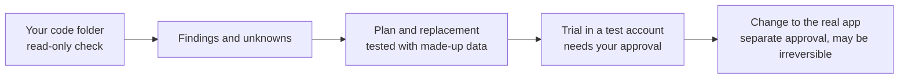

# HubSpot Migration AI Starter

HubSpot's platform changes, and older integrations can stop working. This
starter helps you find out whether something you already have is affected and
plan the change without breaking what works. You start offline with made-up
data, with an AI assistant that follows written safety rules.

> [!WARNING]
> **This is a learning starter, not a migration tool.** It only reads code and
> writes local notes. It is not security-audited, not made or endorsed by
> HubSpot, and has no warranty or support promise. One HubSpot step, moving
> legacy card views to new cards, **cannot be undone**, and this starter never
> runs it. You are responsible for your own migration. See the [disclaimer](#disclaimer).

## What You Get

- An offline check that reads a code folder you choose and lists signs of older
  patterns. It changes nothing and uploads nothing.
- Two small before-and-after examples with made-up data.
- Rules for your AI assistant ([AGENTS.md](AGENTS.md)): what it must never do, and
  when it must ask you first.
- Fill-in templates for an [inventory](templates/inventory.md), a
  [plan](templates/migration-plan.md) and a [verification report](templates/verification-report.md).

This is the kind of comparison the example makes. The data is made up, and no
installed app is touched.

| Old card answer | New card view |
| --- | --- |
| title "Synthetic support request", priority "Normal", status "Open" | Item "Synthetic support request" with Priority: Normal and Status: Open |
| title "Synthetic follow-up", priority "High", status "Pending" | Item "Synthetic follow-up" with Priority: High and Status: Pending |

## Pick Your Path

| You are | Start here | You will have |
| --- | --- | --- |
| New to coding | [Step-by-step walkthrough](docs/start-here.md) | The offline example working and a list of what to find out next |
| Building with an AI assistant | [The first prompt to paste](START_WITH_AI.md) | An assistant that reads first, explains each step and asks before risky ones |
| A developer | [Architecture](docs/developer-architecture.md), [assessment contract](docs/contracts/assessment.md), [recipe support levels](migration-catalog.json) | The code map, report shapes, and tests |

A word you do not know? See the [glossary](docs/glossary.md).

## Try It

You need [Node.js](https://nodejs.org/en/download) 24 or newer and a terminal.
You do **not** need a HubSpot account, a password or key, or any package install.

1. On GitHub choose **Code > Download ZIP**, extract it, and open a terminal in
   the folder that contains `README.md`.
2. Run these two commands (in Windows PowerShell type `npm.cmd` instead of `npm`):

   ```bash
   npm run doctor
   npm run demo
   ```

3. The first command should say `demo mode` and `Installed state: unknown.` You
   are done when the last line of the second says:

   ```text
   Demo passed. No packages installed, no network calls, no HubSpot migration performed.
   ```

**What just happened:** a small program on your computer compared made-up old
and new card data and stopped itself. Nothing was sent to HubSpot and nothing
about your real integration was checked or changed. If a command fails, stop
and read [troubleshooting](docs/troubleshooting.md). Never switch off a check or
type in real credentials to make it pass.

## What To Do Next

1. **Change one small thing:** the [worked exercise](docs/worked-example.md).
2. **Find the topic that matches yours:** the [migration recipes](recipes/README.md)
   and the [reviewed notices and dates](docs/MIGRATION.md).
3. **Write down what you have** before changing anything, using the templates
   above. Keep filled-in copies private.
4. **Understand accounts and testing:** the
   [connection guide](docs/connect-to-hubspot.md). Your assistant must ask you
   before it connects anything.
5. **Before any change to a real app:** [cutover and recovery](docs/cutover-and-recovery.md)
   and the [real-migration checklist](docs/REAL_MIGRATION_CHECKLIST.md). That is a
   separate decision, and some steps cannot be reversed.

## How This Fits With HubSpot's Own Tools

HubSpot's official guides and tools perform the real migration: for example the
guide to [migrating legacy CRM cards to app cards](https://developers.hubspot.com/docs/apps/developer-platform/build-apps/migrate-an-app/migrate-legacy-crm-cards-to-app-cards).
This starter covers what comes before and around them: an offline look at your
code, practice with made-up data, rules for your AI assistant, and a checklist
before cutover. It does not replace the official guides, and it is not a
universal converter.



## Safety Rules In Short

1. Keep passwords, keys, customer data and filled-in reports out of AI chats,
   GitHub, screenshots and logs.
2. Look before you change. Let the assistant inspect only the folder you
   approve, read-only, and never run that folder's scripts during the check.
3. A source backup does not undo a legacy card view migration. Test the
   replacement first and approve each live step separately.

More: [security in plain English](docs/security-for-non-developers.md) and
[the approval steps](docs/non-developer-safety-gates.md).

## For Developers

Run `npm run check:ai`, `npm run check`, `npm test` and `npm run demo`; no
packages are needed. [docs/EVIDENCE.md](docs/EVIDENCE.md) records what was and was not
tested. Reference: [compatibility](docs/COMPATIBILITY.md),
[authentication](docs/auth-options.md), [hosting](docs/hosting-options.md),
the [card](docs/contracts/legacy-card.md) and [progress](docs/contracts/progress.md)
contracts, and [which starter you need](docs/choose-your-path.md).

To save demo progress locally:

```bash
npm run progress -- init --recipe legacy-crm-cards
npm run progress -- show
npm run progress -- check
npm run demo -- --save
```

Only `init` and `demo --save` create files, under the ignored `.migration-local/`
folder, and they do not overwrite existing reports. Saved state is a note to
yourself, not approval for anything.

Optional companion starters, each with its own limits:
[contact card](https://github.com/Jai-HS-Dev/hubspot-contact-card-ai-starter),
[agent tools](https://github.com/Jai-HS-Dev/hubspot-agent-tools-ai-starter) and
[OAuth](https://github.com/Jai-HS-Dev/hubspot-oauth-service-ai-starter). They
are not certified to work together.

## Disclaimer

- **No warranty.** Provided "as is" under the [MIT License](LICENSE), which
  disclaims warranties and limits the authors' liability. Keep the copyright
  and license notice when you reuse the code.
- **A starter, not a product.** The examples are not production-ready, not
  security-audited, and not verified against a live HubSpot account. The
  offline check uses simple pattern matching: finding nothing does not mean
  nothing needs to change.
- **You are responsible for your migration:** testing, security, privacy, legal
  compliance, costs and your customers' data. See
  [implementation responsibility](docs/implementation-responsibility.md).
- **Independent project.** Not affiliated with, endorsed by or supported by
  HubSpot. HubSpot is a trademark of HubSpot, Inc.
- **Not professional advice.** Nothing here is legal, security or compliance
  advice. Dates and requirements here were correct when reviewed and can
  change, so check HubSpot's current announcements.

Help is best-effort with no response-time promise: see [support](docs/SUPPORT.md).
Report security problems privately through [SECURITY.md](SECURITY.md).
